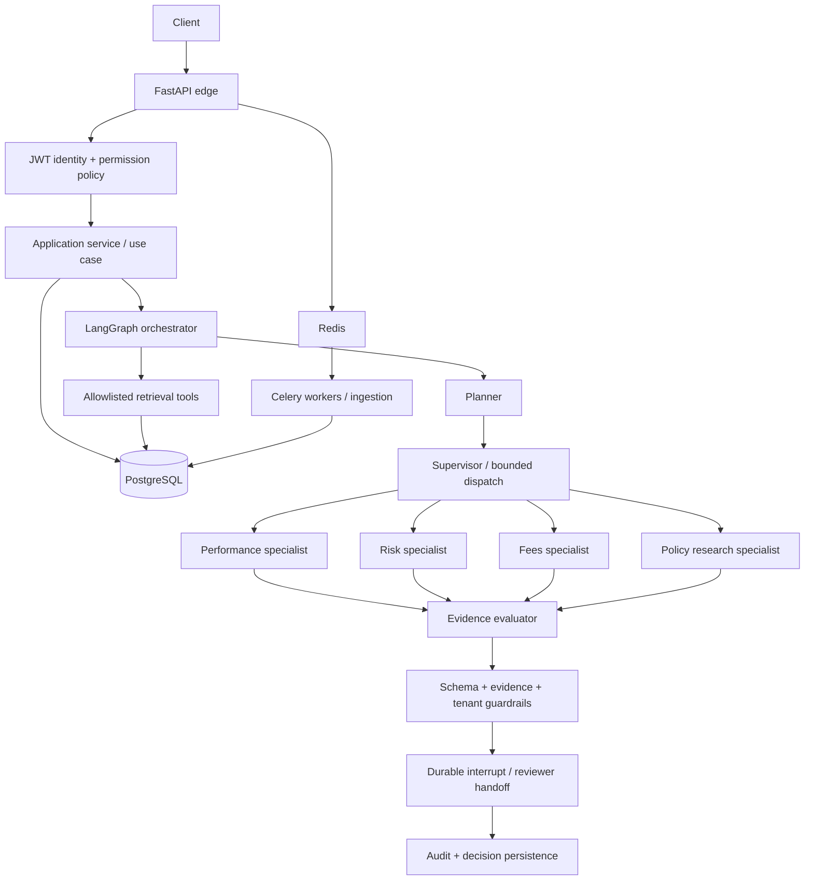

# Financial Compliance Review Platform — Staff/Principal Engineering Edition

A portfolio-grade **reference implementation** for policy-grounded financial-compliance review.
It demonstrates an explicit multi-agent workflow, durable human-in-the-loop (HITL), PostgreSQL +
pgvector retrieval, tenant-aware persistence, RBAC, guardrails, auditability, background ingestion,
and operational design.

## Architecture at a glance



## Design patterns
- **Hexagonal architecture / ports & adapters:** interfaces isolate application logic from SQLAlchemy,
  model providers, and retrieval implementations.
- **Repository:** persistence queries are centralized and tenant-scoped.
- **Unit of Work:** transaction boundaries are explicit; do not hold a DB transaction open while
  waiting for a model or human.
- **Strategy:** vector, keyword, and fallback retrieval are swappable.
- **Factory:** graph and runtime construction are centralized.
- **Command:** review creation and reviewer decisions are validated commands.
- **Supervisor / specialist handoff:** the supervisor dispatches bounded tasks to narrowly scoped
  agents; the graph owns routing, retries, and terminal states.
- **Policy-as-code:** permissions and state transitions are deterministic code, never model output.

## HITL lifecycle
1. Create review and commit it.
2. Run retrieval → planning → specialist work → evaluation → guardrails.
3. LangGraph `interrupt()` pauses with a reviewer packet; PostgreSQL checkpoint preserves state.
4. Reviewer endpoint verifies tenant, permission, review status, and separation-of-duties.
5. Resume the same `thread_id` with a constrained decision command.
6. Persist outcome and append an audit event.

**Important:** never expose an endpoint that resumes arbitrary graph threads. Resolve the review by
tenant first, authorize the reviewer, then resume the exact server-derived thread ID.

## Local development
```bash
cp .env.example .env
docker compose up --build -d
docker compose exec api alembic upgrade head
docker compose exec api pytest
```
The compose stack is for local development. Production needs managed PostgreSQL/Redis, OIDC/JWKS,
secret management, TLS, network policies, backups/PITR, telemetry, and load/security testing.

## What “enterprise-ready” means here
This is a **serious reference scaffold**, not a claim of certified production readiness. The package
includes core architectural patterns and implementation seams; before real financial data is used,
complete the checklist in `docs/PRODUCTION_READINESS.md`, run integration tests against real services,
and get security/compliance sign-off. In particular, validate LangGraph checkpoint compatibility
with your pinned versions, run RLS tests under a non-owner DB role, and implement your organisation's
identity provider and data-retention rules.

## Version 3.1.0 reliability updates

This revision adds transactionally persisted outbox events, tenant-scoped idempotency keys, creator/reviewer separation of duties, centralized review transitions, tenant transaction context, bounded LangGraph rework, policy version metadata, hybrid retrieval, and audit read access. Apply migrations with `alembic upgrade head`. Run Celery Beat alongside the worker; the worker must consume both `reviews` and `outbox` queues. See `docs/PRODUCTION_READINESS.md` and `docs/KNOWN_LIMITATIONS.md` for deployment requirements and remaining validation work.


## Local Docker setup (3.1.0)

1. Copy `.env.example` to `.env` and `.env.runtime.example` to `.env.runtime`; set strong, matching database credentials and a long JWT secret. The application loads `.env.runtime` for local execution; Compose injects the same values into containers.
2. Run `docker compose up --build -d`. A one-shot `migrate` service applies Alembic migrations before the API, worker, and Beat services start.
3. The Compose stack includes PostgreSQL, Redis, the migration job, API, a Celery worker consuming `reviews,outbox`, and one Celery Beat publisher. The database init script creates a non-superuser `app_user` role; API and worker containers do not use the PostgreSQL administrator account.

For an existing PostgreSQL volume, read the migration and role-upgrade notes in `docs/PRODUCTION_READINESS.md` before starting the new application.

## Staff-level domain expansion

See `docs/STAFF_LEVEL_UPGRADE_BLUEPRINT.md` for the target financial-services architecture, prioritized capability roadmap, security/reliability decisions and acceptance criteria. See `docs/STAFF_LEVEL_INTERVIEW_STORY.md` for a truthful interview narrative and deep-dive answers. These documents distinguish current code from proposed capabilities; roadmap items are not represented as implemented features.

## Staff-level capability modules (revision 3.2.0)

This revision adds executable reference modules for adaptive task planning, document intake, evidence provenance, semantic claim evaluation, contradiction checks, deterministic portfolio stress scenarios, policy version impact candidates, least-privilege connector contracts, OIDC/JWKS verification and optional OpenTelemetry bootstrap. The adaptive planner is wired into the LangGraph planning node; the other modules are service components and are not falsely represented as end-to-end production integrations.

See [`docs/SEVEN_STAFF_CAPABILITIES_STATUS.md`](docs/SEVEN_STAFF_CAPABILITIES_STATUS.md) for an item-by-item implementation boundary, and [`docs/STAFF_LEVEL_UPGRADE_BLUEPRINT.md`](docs/STAFF_LEVEL_UPGRADE_BLUEPRINT.md) for target architecture. Run `pip install -e '.[dev]' && pytest -q`. Optional extras: `pip install -e '.[observability]'` and `pip install -e '.[performance]'`.
